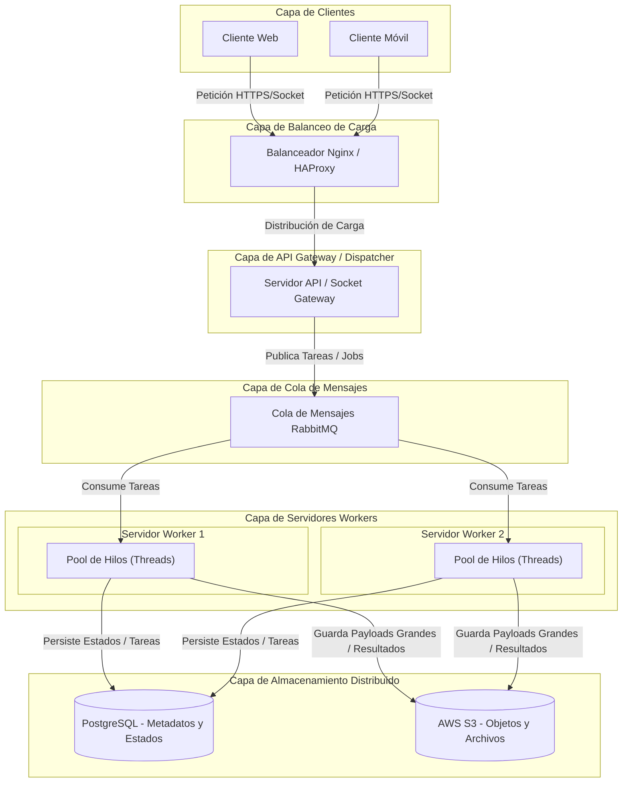
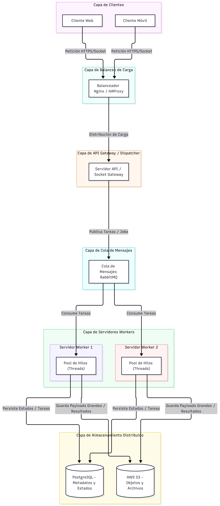

# Práctica Formativa Obligatoria 3 (PFO 3) - Programación sobre Redes
## Rediseño como Sistema Distribuido (Cliente-Servidor)

### Descripción del Proyecto
Evolución de la arquitectura cliente-servidor tradicional hacia un sistema distribuido y concurrente. El sistema implementa un servidor despachador (*dispatcher*) basado en sockets TCP que distribuye tareas computacionales a un pool de hilos trabajadores (*workers*), garantizando el desacoplamiento y la no-bloqueancia de las solicitudes entrantes.

---

### Diagrama de Arquitectura Distribuida

A continuación se presenta la arquitectura empresarial de referencia para procesamiento distribuido desacoplado:



#### Imagen de Respaldo del Diagrama


#### Justificación de los Componentes del Sistema Distribuido:
* **Clientes (Móviles y Web):** Representan los puntos de entrada hetero-plataforma que generan peticiones de servicio.
* **Balanceador de Carga (Nginx / HAProxy):** Expone un punto único de entrada, mitigando cuellos de botella y balanceando el tráfico entrante hacia múltiples instancias del Gateway mediante algoritmos como *Round Robin* o *Least Connections*.
* **Cola de Mensajes (RabbitMQ):** Actúa como *message broker* asíncrono para desacoplar temporal y espacialmente la recepción de solicitudes respecto al procesamiento pesado.
* **Servidores Workers con Pool de Hilos:** Nodos de procesamiento dedicados que consumen tareas de la cola y las procesan concurrentemente utilizando pools de hilos (`thread pool`), evitando bloqueos en el hilo principal.
* **Almacenamiento Distribuido (PostgreSQL y S3):** 
  * **PostgreSQL:** Persistencia transaccional ACID para control de estados, usuarios y metadatos de las tareas.
  * **Amazon S3 / Almacenamiento de Objetos:** Depósito distribuido para almacenar artefactos de gran tamaño, archivos generados o resultados pesados sin sobrecargar la base relacional.

---

### Estructura de Archivos del Entregable
* `servidor.py`: Servidor TCP con despacho multihilo mediante `ThreadPoolExecutor` y gestión de tareas distribuidas.
* `cliente.py`: Cliente interactivo por consola que serializa peticiones en formato JSON y recibe resultados estructurados.
* `diagrama.png`: Imagen renderizada del diseño de la arquitectura distribuida.
* `README.md`: Documentación técnica, esquema arquitectónico en Mermaid e instrucciones de uso.

---

### Tipos de Tareas Disponibles
1. **Tarea de Cómputo (Cálculo de Primos):** Simula una carga de procesamiento CPU-bound mediante el cálculo y filtrado de números primos hasta un límite definido.
2. **Tarea Criptográfica (Hasheo):** Aplica funciones de resumen unidireccionales (MD5 y SHA-256) sobre texto plano provisto por el usuario.
3. **Tarea Intensiva / I/O (Simulación de retardo):** Simula operaciones I/O-bound o llamadas a sistemas lentos bloqueando un worker específico durante una ventana de tiempo sin detener la atención a otros clientes concurrentes.

---

### Instrucciones de Ejecución

1. **Iniciar el Servidor Distribuidor:**
   Abrir una terminal en el directorio del proyecto y ejecutar:
   ```bash
   py servidor.py
   ```
   El servidor quedará a la escucha en `localhost:5000` con 4 workers concurrentes inicializados.

2. **Iniciar el Cliente:**
   Abrir una segunda terminal (o múltiples terminales para probar concurrencia) y ejecutar:
   ```bash
   py cliente.py
   ```

3. **Demostración de Concurrencia:**
   * Enviar una tarea intensiva (opción 3) solicitando 5 segundos desde un cliente.
   * Inmediatamente, desde otra consola con un segundo cliente, enviar una tarea de hash (opción 2) o primos (opción 1).
   * Se observará que el segundo cliente recibe respuesta inmediata mediante un hilo trabajador libre (`Worker_1`), comprobando la no-bloqueancia del sistema distribuido.
